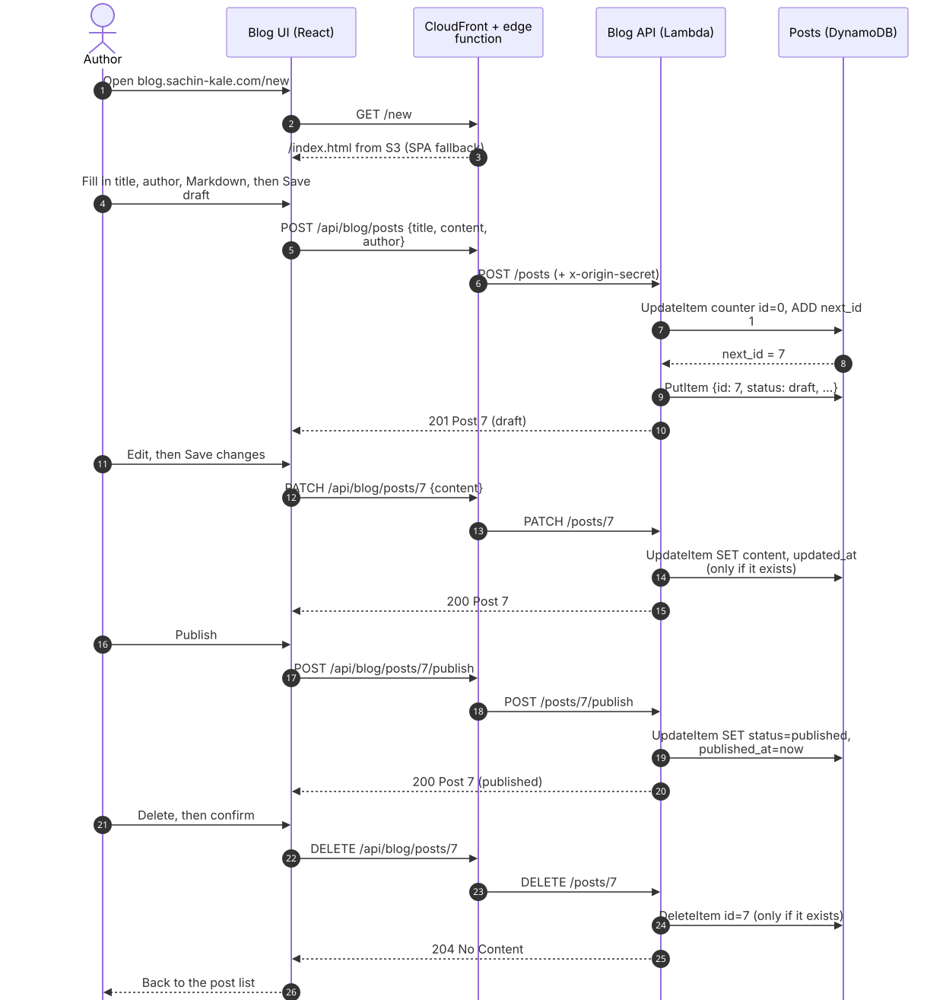
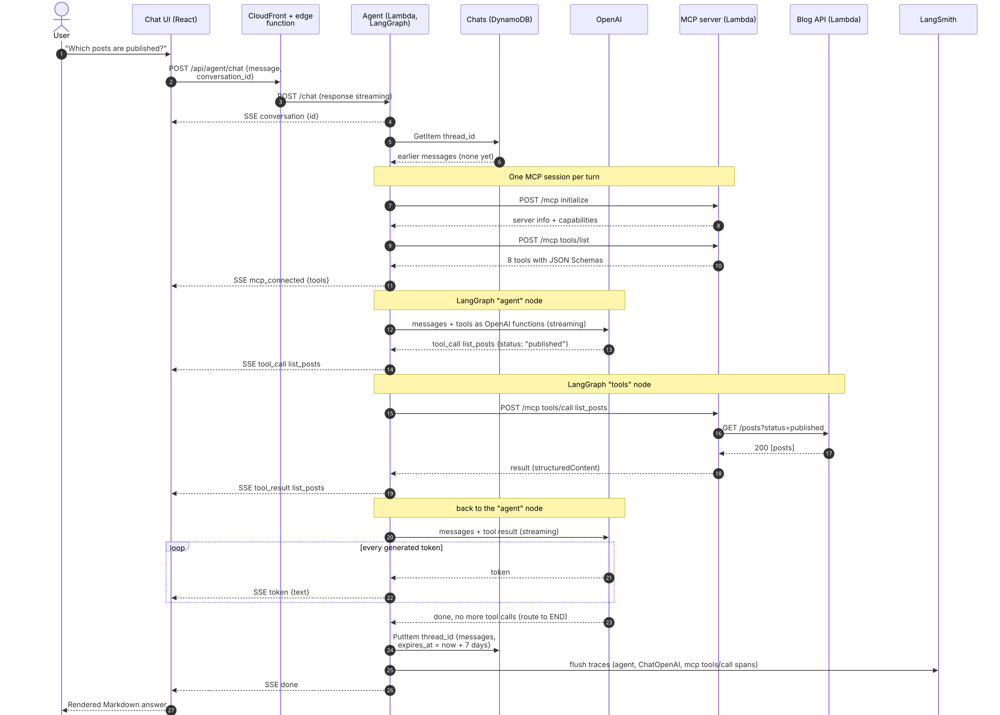
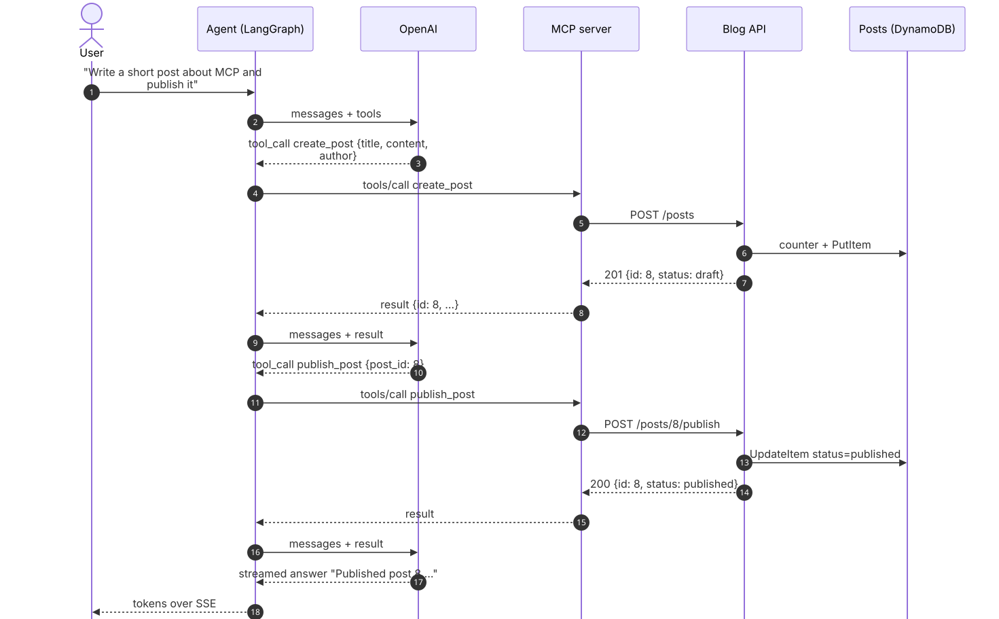
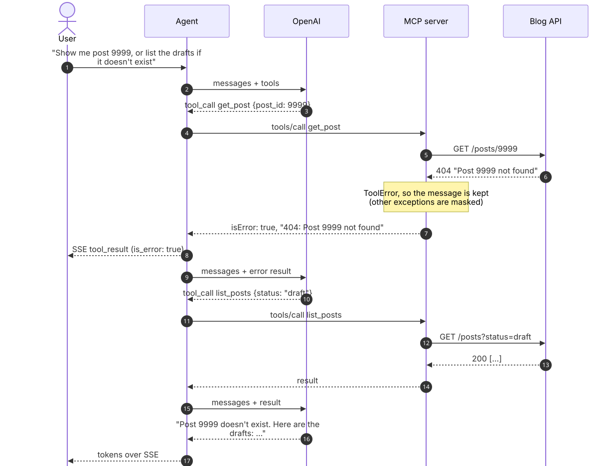
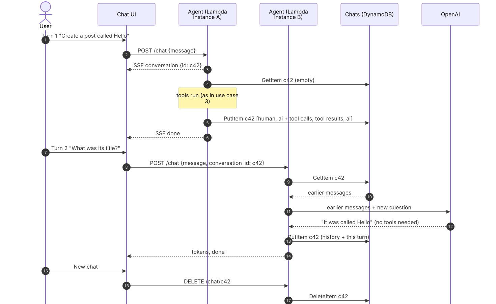
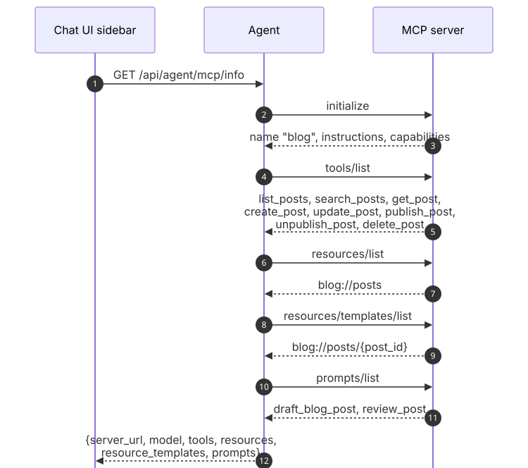
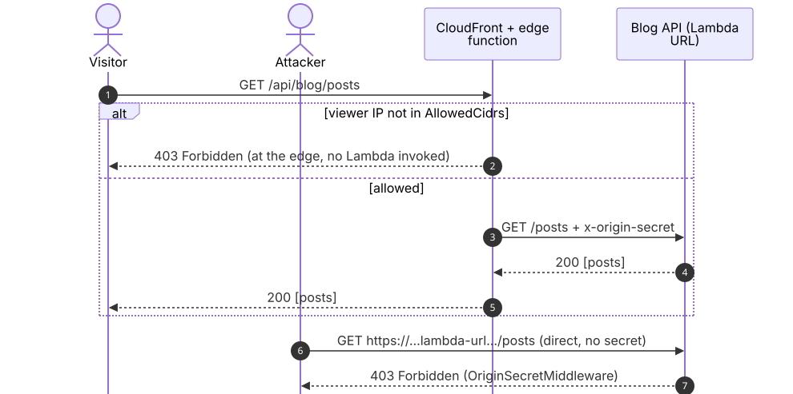
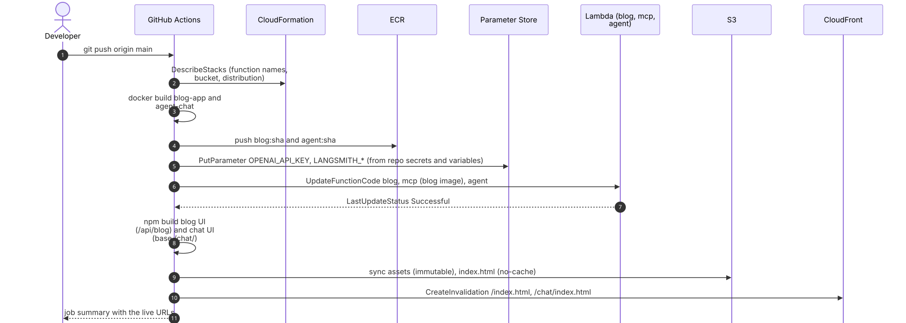
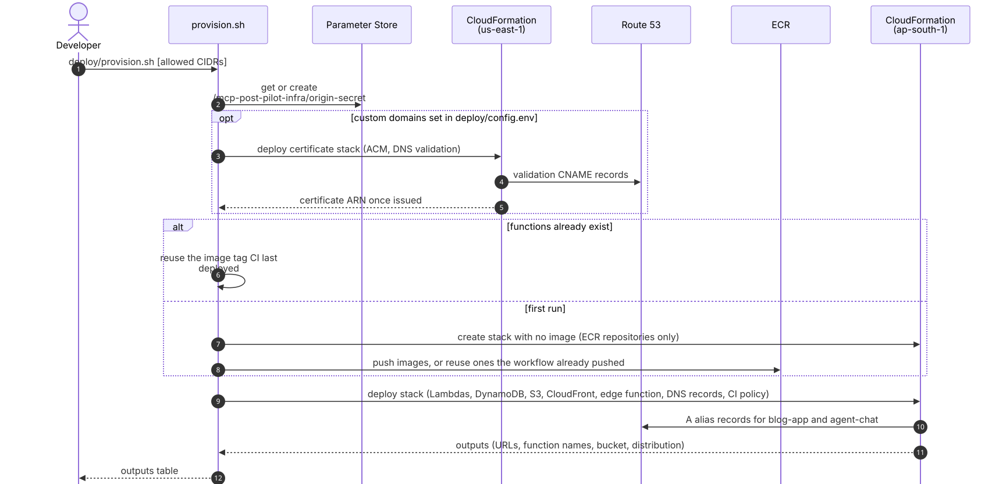

# Use cases

How requests flow through MCP Post Pilot, shown as sequence diagrams. The diagrams describe the
AWS deployment ([README › Deploy to AWS](README.md#deploy-to-aws-serverless)); locally the same code
runs with Postgres instead of DynamoDB, in-memory chat history, no CloudFront, and no origin secret.

| # | Use case | Actor |
|---|---|---|
| 1 | [Manage a post in the blog UI](#1-manage-a-post-in-the-blog-ui) | Author |
| 2 | [Ask the agent a question](#2-ask-the-agent-a-question) | Chat user |
| 3 | [Have the agent create and publish a post](#3-have-the-agent-create-and-publish-a-post) | Chat user |
| 4 | [Agent recovers from a tool error](#4-agent-recovers-from-a-tool-error) | Chat user |
| 5 | [Continue a conversation](#5-continue-a-conversation) | Chat user |
| 6 | [Discover what the MCP server offers](#6-discover-what-the-mcp-server-offers) | Chat UI / any MCP client |
| 7 | [Blocked requests](#7-blocked-requests) | Anyone |
| 8 | [Deploy a change](#8-deploy-a-change) | Developer |
| 9 | [Provision or change infrastructure](#9-provision-or-change-infrastructure) | Developer |

**Components**

| Name in diagrams | What it is |
|---|---|
| CloudFront | CDN for `blog.sachin-kale.com` and `agent.sachin-kale.com` |
| Edge function | CloudFront Function on every request: IP allow-list, `/api/*` prefix stripping, SPA fallback |
| Blog API | Lambda `mcp-post-pilot-blog`: FastAPI REST API (`blog-app/backend`) |
| MCP server | Lambda `mcp-post-pilot-mcp`: MCP over Streamable HTTP, stateless (`blog-app/mcp_server`) |
| Agent | Lambda `mcp-post-pilot-agent`: FastAPI + LangGraph, streams SSE (`agent-chat/backend`) |
| Posts / Chats | DynamoDB tables for posts and conversation history |

Every hop from CloudFront to a Lambda, and from Lambda to Lambda, carries the `x-origin-secret`
header. The diagrams leave it out except in [use case 7](#7-blocked-requests).

The diagrams are SVG images rendered from Mermaid sources in [`docs/diagrams/`](docs/diagrams).
After editing a `.mmd` file, regenerate the images with `docs/diagrams/render.sh`.

---

## 1. Manage a post in the blog UI

The author creates a draft, edits it, publishes it, views it and deletes it. The React app calls
`/api/blog/...`; the edge function strips the prefix, so the Blog API sees plain `/posts...` paths.

Source: [`docs/diagrams/01-manage-a-post-in-the-blog-ui.mmd`](docs/diagrams/01-manage-a-post-in-the-blog-ui.mmd)

---

## 2. Ask the agent a question

The core MCP flow. For each chat turn the agent opens an MCP session, discovers the tools, offers
them to the LLM and executes the calls the LLM asks for. The answer streams back as Server-Sent
Events (`event: token`, `event: tool_call`, ...).

Source: [`docs/diagrams/02-ask-the-agent-a-question.mmd`](docs/diagrams/02-ask-the-agent-a-question.mmd)

---

## 3. Have the agent create and publish a post

The LLM chains two tools: it needs the new post's id from `create_post` before it can call
`publish_post`, so the agent ⇄ tools loop runs twice before the final answer.

Source: [`docs/diagrams/03-have-the-agent-create-and-publish-a-post.mmd`](docs/diagrams/03-have-the-agent-create-and-publish-a-post.mmd)

When the LLM asks for several independent tools in one response (for example `get_post` for two
ids), the tools node runs the MCP calls concurrently and returns all results together.

---

## 4. Agent recovers from a tool error

A failing tool doesn't crash the turn. The MCP server raises `ToolError`, which becomes a result
with `isError: true` and a readable message. The agent passes it to the LLM, which can try another
approach.

Source: [`docs/diagrams/04-agent-recovers-from-a-tool-error.mmd`](docs/diagrams/04-agent-recovers-from-a-tool-error.mmd)

---

## 5. Continue a conversation

Lambda instances are short-lived and requests can land on different ones, so conversation history
can't live in memory. It is loaded from DynamoDB at the start of each turn and saved at the end.
The history is saved only after a turn completes, so a failed turn never stores half a tool exchange.

Source: [`docs/diagrams/05-continue-a-conversation.mmd`](docs/diagrams/05-continue-a-conversation.mmd)

History older than 7 days is removed by DynamoDB TTL. Very long histories are trimmed from the
oldest turn, always at a user message, so a tool call is never separated from its result.

---

## 6. Discover what the MCP server offers

The chat UI's sidebar lists everything the server advertises. Any MCP client can do the same. For
example, locally: `blog-app/scripts/try_mcp_client.py` or `npx @modelcontextprotocol/inspector`
against `http://127.0.0.1:8101/mcp`.

Source: [`docs/diagrams/06-discover-what-the-mcp-server-offers.mmd`](docs/diagrams/06-discover-what-the-mcp-server-offers.mmd)

Tools carry annotations: `readOnlyHint` on the read tools, `idempotentHint` on update,
publish and unpublish, `destructiveHint` on `delete_post`. A client can use them to ask for confirmation before
destructive calls.

---

## 7. Blocked requests

The two layers that guard the public endpoints: the edge function's IP allow-list (configurable,
currently open to everyone), and the origin secret, which makes the Lambda function URLs useless
without going through CloudFront.

Source: [`docs/diagrams/07-blocked-requests.mmd`](docs/diagrams/07-blocked-requests.mmd)

The same check protects the MCP server: the agent sends the secret through a custom HTTP client,
and the MCP server sends it on to the Blog API. Locally, where no secret is set, the MCP server
instead uses DNS-rebinding protection, accepting only localhost `Host` headers.

---

## 8. Deploy a change

Every push to `main` runs `.github/workflows/deploy.yml` with the `github-actions-deployer` IAM user.
Its policy allows exactly these actions on exactly these resources.

Source: [`docs/diagrams/08-deploy-a-change.mmd`](docs/diagrams/08-deploy-a-change.mmd)

New Lambda instances read the settings from Parameter Store when they start (`settings.py`).

---

## 9. Provision or change infrastructure

`deploy/provision.sh` runs with the developer's own AWS credentials, which can create IAM roles,
unlike the CI user. It's needed only for infrastructure changes, domain changes or a new IP allow-list.

Source: [`docs/diagrams/09-provision-or-change-infrastructure.mmd`](docs/diagrams/09-provision-or-change-infrastructure.mmd)
