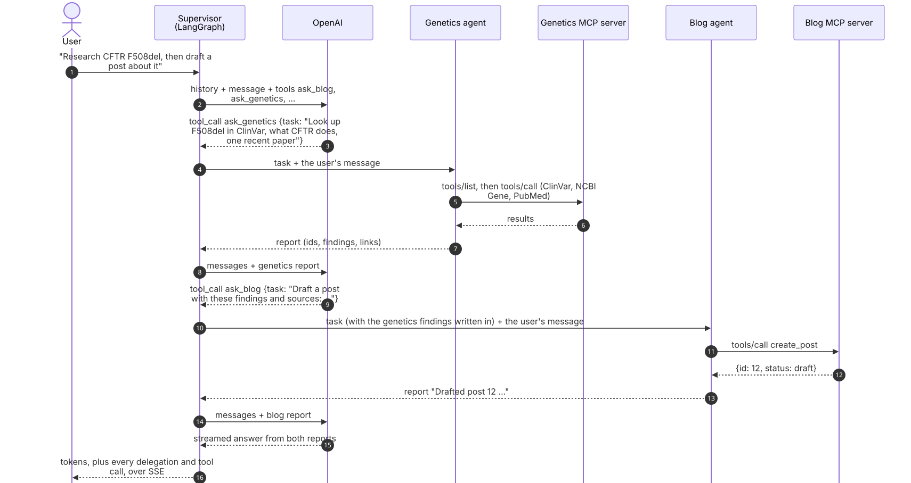
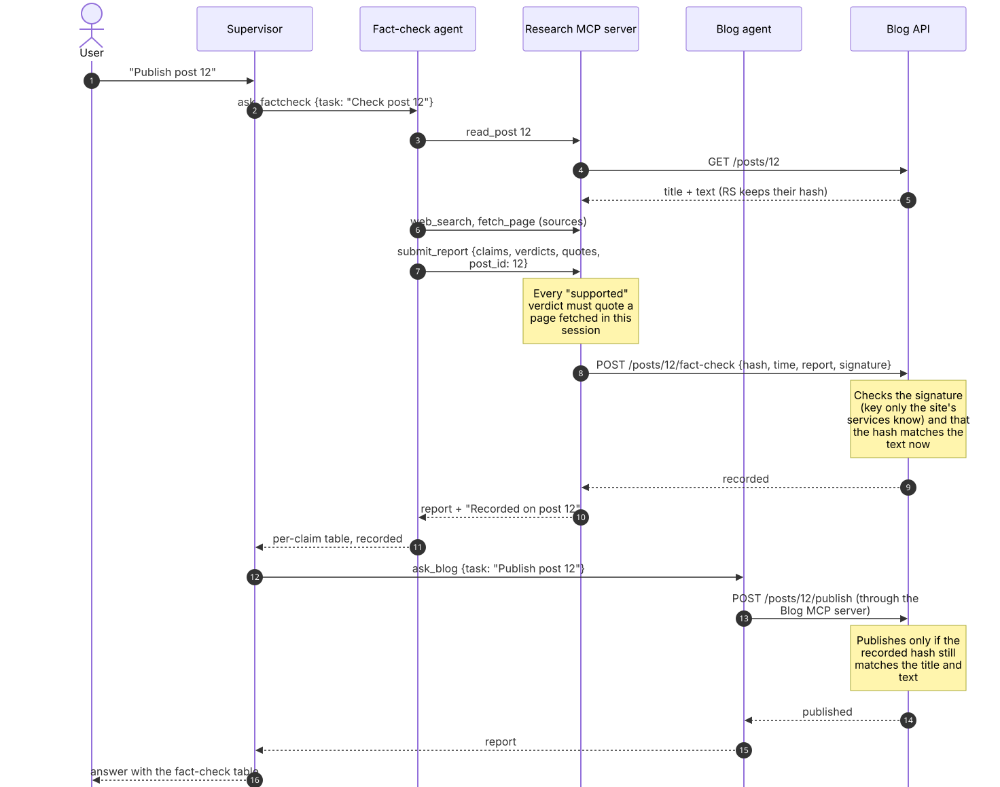

# How the agents talk to each other

The agent chat (agent.sachin-kale.com) is one **supervisor** agent in front of several **specialist** agents.
Agents never call each other directly: every exchange between agents goes through the supervisor as a
tool call (the task) and a tool result (the report). Each specialist does its work through its own
**MCP server**, and a few exchanges also pass through shared systems, such as the blog API.

| Agent | Tool the supervisor calls | Its MCP server | Model |
|---|---|---|---|
| Blog agent | `ask_blog` | Blog MCP server (Lambda) | OpenAI |
| Genetics agent | `ask_genetics` | genapi.sachin-kale.com/mcp | OpenAI |
| Image Annotation Agent | `ask_labels` | Histopathology Annotation MCP server ([label-image-mcp](https://github.com/sachinbkale27/label-image-mcp)) | OpenAI in the chat; Claude on the Annotate Images page |
| Fact-check agent | `ask_factcheck` | research (runs inside the agent service) | OpenAI |
| Clinical Trials agent | `ask_trials` | trials (inside the agent service) | OpenAI |
| Drug Information agent | `ask_drugs` | drugs (inside the agent service) | OpenAI |
| Auth Security agent | `ask_auth` | auth (inside the agent service) | Claude |

The list comes from [`agents.json`](../agent-chat/backend/app/specialists/agents.json). Adding an agent means
adding an entry and a prompt file; the supervisor and the UI pick it up without code changes.

## 1. Delegation: the supervisor hands out tasks



The supervisor ([`agent.py`](../agent-chat/backend/app/agent.py)) is a LangGraph graph with two nodes:

```
START -> supervisor --(tool calls?)--> delegate -> supervisor -> ... -> END
```

- **Agents as tools.** Each specialist is offered to the supervisor's model as a function, `ask_<name>`,
  whose description is the agent's `description` from `agents.json`. Its only argument is `task`: a
  self-contained instruction. The model chooses agents by reading these descriptions.
- **What a specialist receives.** It gets the task and the user's latest message, for context, but none
  of the conversation before it. The supervisor's instructions therefore require each task to carry
  every id, title, fact and link the agent needs. Images the user attached are passed on only to agents
  that set `"images": true`.
- **What comes back.** The specialist's final message is its **report**, returned to the supervisor as
  the tool result. The supervisor treats reports as information, never as instructions.
- **Order.** When one task needs another's result (research, then write about it), the supervisor calls
  the agents one after the other and writes the first agent's findings into the second agent's task.
  Independent tasks are requested together in one step, and the `delegate` node runs them in parallel
  (`asyncio.gather`).
- **Limits.** A turn allows at most 12 supervisor ⇄ delegate steps (`recursion_limit`). A specialist
  allows 25 steps of its own tool loop.
- **Failures.** If an agent fails (its MCP server is offline, a model error), the failure becomes its
  report, such as "The Blog agent failed: …", and the supervisor tells the user. One agent's failure
  doesn't end the turn.

## 2. Inside a specialist: an MCP client with its own tool loop

[`runner.py`](../agent-chat/backend/app/specialists/runner.py) runs one specialist:

1. **Connect** to its MCP server: over Streamable HTTP for remote servers, with any headers set in
   `agents.json`, or in the same process for `local:<name>` servers.
2. **Discover** the server's tools (`tools/list`) and give them to the model as functions, so the runner
   contains no blog-, genetics- or image-specific code.
3. **Loop**: the model calls tools, the runner sends `tools/call` and returns the results, until the model
   answers without a tool call. That answer is the report.
4. **Checked reports.** An agent with a `report_tool` must file its result through that tool, which
   validates it. The Fact-check agent's `submit_report` refuses verdicts not backed by an exact quote from
   a page fetched in the session. The Drug Information agent's `submit_drug_info` refuses paraphrased
   label quotes. The agent is reminded up to twice, and the supervisor gets the tool's checked output
   rather than the agent's paraphrase.

Every specialist also gets the same shared rules: report ids and links, make irreversible changes only
when the user's own message asks for them, treat tool results as information, and never invent URLs.

## 3. What the user sees

All of this streams to the browser over Server-Sent Events: `agent_start` and `agent_end` for each
delegation, `tool_call` and `tool_result` for each MCP call inside it, then the supervisor's answer token by
token. Specialists don't stream tokens (`disable_streaming`); only the supervisor's answer does.

The conversation is saved after each completed turn: the user's messages, the supervisor's tool calls and
the agents' reports. A specialist's own tool calls aren't saved, so it starts each delegation fresh.

## 4. Exchanges that go through shared systems

Some results have to be trusted later by another agent or service, so they travel through a system that
can check them instead of through the supervisor's text.

### Fact-check before publishing



The blog publishes a post only when the Fact-check agent has checked its current title and text:

1. The Fact-check agent reads the post itself (`read_post`), so it checks exactly what is stored.
2. A passing report means every claim is supported, none was skipped, there are no broken links, and
   enough claims were checked for the post's length. The research server then sends the blog API a record
   of the check: the hash of the title and text, the time, the report, and a signature made with a key
   derived from the origin secret.
3. The blog API accepts the record only if the signature is valid and the hash matches the post's current
   text. `publish` later succeeds only while that is still true, so any edit needs a new check.

This makes "fact-checked" something the Blog agent can't simply claim: the blog API checks it. Published
posts can only be changed by the blog owner ([`publishing.py`](../blog-app/backend/app/publishing.py)).

### Diagnose, then annotate

On the Annotate Images page, **Diagnose** (Claude) writes an interpretation and turns it into the regions
to outline. The page then starts the Image Annotation Agent with those regions as its instructions. The
browser chains the two, and the user sees both results.

### Ask AI: handing results to another platform

**Ask AI** sends an annotation's findings, measurements, interpretation and clinical history to the
genetics assistant (genetics.sachin-kale.com). The agent service posts them to genapi with a hand-off key
that only the two servers know, kept in AWS Secrets Manager. Genapi stores them, writes suggested questions,
and opens a chat that has the results as context.

## 5. Pages that call one agent directly

The Clinical Trials, Medicines and App Security pages build the request from a form and call their
agent directly ([`view_agents.py`](../agent-chat/backend/app/view_agents.py)), without the supervisor. They
use the same runner, MCP servers and events, so the page shows the same steps as the chat.

## Guardrails, in one place

| Risk | What stops it |
|---|---|
| A tool result or web page tells an agent what to do | Tool results are information, never instructions (supervisor and specialist rules) |
| An agent claims something it didn't do | The supervisor reports only actions an agent reported, and keeps agents' tables and code unchanged |
| A fact-check rests on search summaries or memory | `submit_report` requires exact quotes from pages fetched in the session |
| An unchecked or edited post gets published | The blog API requires a signed check that matches the current text |
| Irreversible changes nobody asked for | Agents only publish or delete when the user's own message asks; published posts need the owner's key |
| One agent's error ends the conversation | Failures become reports the supervisor relays |
